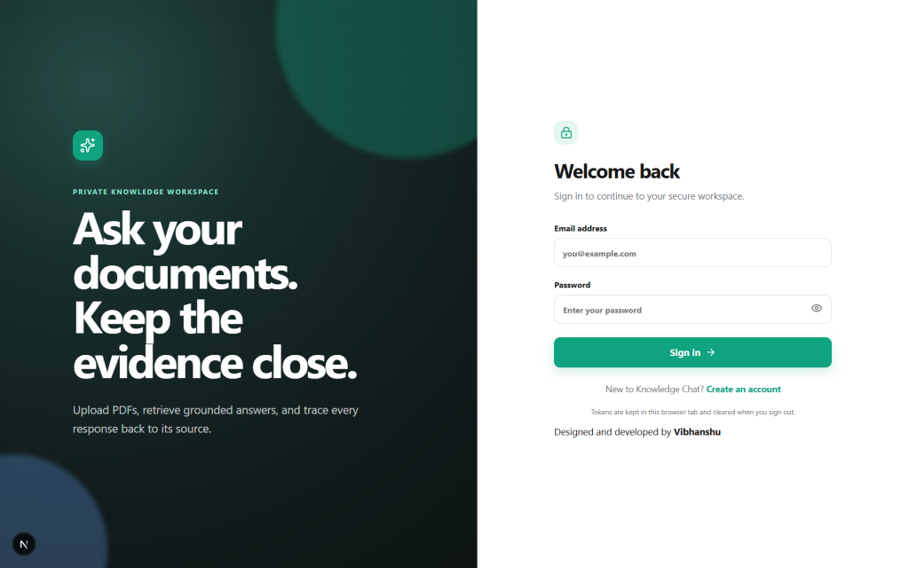
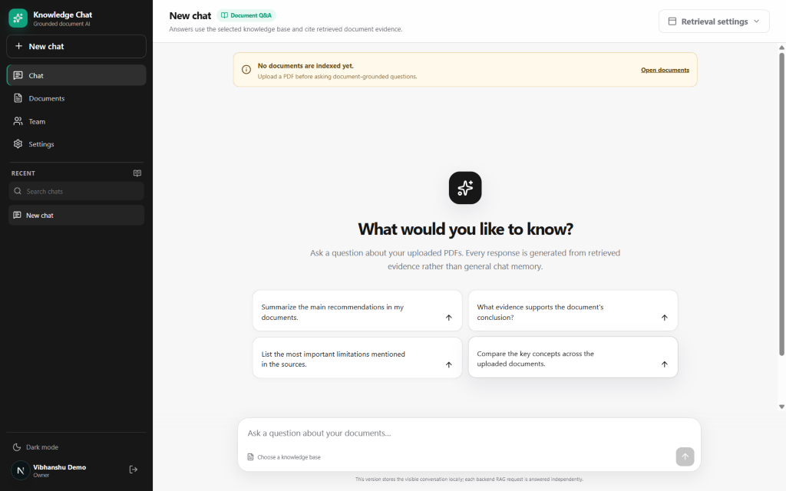

# Organizational Knowledge Intelligence System — Multi-Tenant RAG Platform

Most RAG demos stop right after "upload a PDF, embed it, and ask a question." This project is built around everything that comes *after* that first prototype works: user accounts, organizations and departments, role-based access, background ingestion that doesn't block HTTP requests, document publishing and version control, rate limiting, and local or cloud LLM support.

Under the hood, the backend runs on **FastAPI (Python)** with **MySQL**, **Redis**, and **ChromaDB**, while the frontend is built with **Next.js and TypeScript**. Embeddings run locally via **Hugging Face** (`all-MiniLM-L6-v2`), and answer generation defaults to **local Ollama** (`llama3.2:3b`) so you can run the entire stack on your own machine without needing an API key — or switch to **Gemini** or **OpenAI** with a single environment setting.

---

## Application Preview

### Sign-In Page


### Knowledge Chat Workspace (After Login)


---

## What It Does

Instead of keeping everything in one flat script, the platform separates concerns cleanly across the stack:

- **Grounded Document Q&A** — Answers are generated strictly from retrieved document chunks and include source citations (`[S1]`, `[S2]`, ...), so you can always trace where an answer came from.
- **PDF & DOCX Ingestion** — Upload PDF or Word documents through the web UI or API. Files are loaded, parsed, cleaned, split into overlapping chunks, and tagged with tenant and department metadata.
- **Background Ingestion Worker** — Uploads return immediately while a dedicated worker (`backend.app.workers.document_ingestion_worker`) picks jobs up from **Redis**, tracks progress in **MySQL**, handles retries with backoff, recovers stale jobs, and reports monitoring stats.
- **Document Lifecycle & Versioning** — Documents move through explicit states (`publish`, `unpublish`, `archive`), track SHA-256 content hashes to handle updates/replacements cleanly, and keep ChromaDB vectors synchronized when documents are changed or deleted.
- **Organizations, Departments & RBAC** — Every workspace is tenant-isolated:
  - **Organization roles**: `owner`, `admin`, `member`, `viewer`
  - **Department roles**: `department_admin`, `employee`
  - Documents can be scoped to an entire organization or restricted to a specific department, with audit logs recording key actions.
- **Pluggable LLMs & Embeddings** — Runs locally out of the box with **Ollama** (`llama3.2:3b`) and **Hugging Face** embeddings, or swaps to **Google Gemini** (`gemini-2.5-flash`) or **OpenAI** (`gpt-5.4-mini`) via `.env`.
- **Production Guardrails** — Argon2 password hashing, JWT access + refresh token rotation, Redis-backed per-endpoint rate limiting, CORS and trusted-host middleware, structured logging (`structlog`), and liveness/readiness health endpoints.

---

## How Everything Fits Together

```text
User
 │
 ▼
Next.js Frontend (http://localhost:3000)
 │
 ▼
FastAPI Backend (http://127.0.0.1:8000/api/v1)
 │
 ├── Auth & Refresh Tokens (JWT + Argon2)
 ├── Organization & Department RBAC
 ├── Document Lifecycle & Job APIs
 ├── RAG Query Service
 ├── Audit Logging & Security Middleware
 └── Redis Rate Limiting
 │
 ├───────────────┬───────────────┬───────────────┬───────────────┐
 ▼               ▼               ▼               ▼               ▼
MySQL          Redis          ChromaDB      Ingestion        LLM Provider
(Users, Orgs,  (Rate Limits   (Org & Dept   Worker           (Ollama /
 Depts, Docs,   & Job Queue)   Isolated      (PDF/DOCX ->     Gemini /
 Jobs, Audit)                  Vectors)       Embeddings)     OpenAI)
```

---

## How Documents Flow Through the System

### 1. Uploading & Indexing (Async)

```text
PDF / DOCX Upload ──► Local File Storage + MySQL Document & Job Record
                             │
                             ▼ (Job ID pushed to Redis)
                 Document Ingestion Worker
                             │
                             ▼
           Loader (PDF/DOCX) ──► Parser ──► Text Cleaner ──► Chunker
                             │
                             ▼
             Hugging Face Embeddings ──► ChromaDB (Org/Dept Scoped)
```

### 2. Asking a Question

```text
User Question
    │
    ▼
Query Embedding (Hugging Face)
    │
    ▼
Chroma Similarity Search (Filtered by Org, Department & Published Status)
    │
    ▼
Retrieved Chunks + Grounding Prompt
    │
    ▼
LLM Provider (Ollama / Gemini / OpenAI)
    │
    ▼
Grounded Answer + Source References
```

---

## Project Structure

```text
.
├── backend/
│   └── app/
│       ├── api/                        # FastAPI app, routes, schemas, security & rate-limit middleware
│       │   ├── app.py
│       │   ├── auth_routes.py
│       │   ├── department_routes.py
│       │   ├── document_management_routes.py
│       │   ├── health_routes.py
│       │   ├── organization_routes.py
│       │   └── routes.py
│       ├── auth/                       # JWT helpers, Argon2 hashing, RBAC role rules, auth service
│       ├── core/                       # Environment config, custom exceptions, structlog setup
│       ├── database/                   # Async SQLAlchemy models, enums, repositories, session management
│       ├── embeddings/                 # Hugging Face & OpenAI embedding providers
│       ├── generation/                 # Grounding prompts & response generation service
│       ├── ingestion/                  # PDF/DOCX loaders, parsers, text cleaner, chunker, metadata builder
│       ├── llms/                       # Unified LLM factory (Ollama, Gemini, OpenAI)
│       ├── organizations/              # Organization & department management services
│       ├── rate_limiting/              # Redis rate limiter & FastAPI dependencies
│       ├── retrieval/                  # Tenant-isolated vector search service
│       ├── services/                   # Document management, ingestion, storage, job queue, telemetry, RAG, health
│       ├── vectorstores/               # Tenant-isolated ChromaDB vector store adapter
│       ├── workers/                    # Background document ingestion worker
│       └── main.py                     # Uvicorn entrypoint
│
├── frontend/
│   ├── app/
│   │   ├── (auth)/                     # Sign-in & registration pages
│   │   └── (dashboard)/                # Chat, Documents, Team/Members, Settings pages
│   ├── components/                     # Workspace UI components, sidebar, auth/chat/toast providers
│   ├── lib/                            # Typed API client, formatters, TypeScript types
│   ├── .env.example
│   ├── API_CONTRACT.md
│   ├── openapi.json
│   └── package.json
│
├── docs/
│   └── images/                         # README screenshots (login-page.png, chat-workspace.png)
├── migrations/                         # Alembic database migrations
│   └── versions/
├── scripts/                            # Helper scripts (dev token generator, OpenAPI export)
├── tests/                              # Pytest unit & integration suite
├── .env.example
├── .env.docker.example
├── alembic.ini
├── compose.yml
├── pyproject.toml
└── uv.lock
```

---

## Getting It Running Locally

### 1. Set Up the Backend Environment

Copy `.env.example` to `.env` and fill in your database password and JWT secret:

```powershell
Copy-Item .env.example .env
```

Out of the box, `.env.example` uses **local Ollama** (`LLM_PROVIDER=ollama`, `OLLAMA_LLM_MODEL=llama3.2:3b`) and **Hugging Face embeddings** (`sentence-transformers/all-MiniLM-L6-v2`).

Make sure Ollama is running and has the model pulled:

```bash
ollama pull llama3.2:3b
```

*(Prefer a cloud model? Switch `LLM_PROVIDER=gemini` with `GEMINI_API_KEY`, or `LLM_PROVIDER=openai` with `OPENAI_API_KEY` in `.env`.)*

### 2. Install Python Dependencies

The backend uses `uv` with Python 3.12+:

```bash
uv sync
```

### 3. Start MySQL & Redis

Copy `.env.docker.example` to `.env.docker` (matching the credentials in your `.env` `DATABASE_URL`), then start MySQL with Docker Compose:

```bash
docker compose up -d
```

Make sure Redis is also running on `127.0.0.1:6379` (for rate limiting and the ingestion queue):

```bash
docker run -d --name rag-redis -p 127.0.0.1:6379:6379 redis:7-alpine
```

### 4. Run Database Migrations

```bash
uv run alembic upgrade head
```

### 5. Start the FastAPI Server

```bash
uv run uvicorn backend.app.main:app --reload
```

- **API base URL**: `http://127.0.0.1:8000`
- **Interactive Swagger docs**: `http://127.0.0.1:8000/docs`

### 6. Start the Document Ingestion Worker

Open a second terminal so uploaded documents are picked up and indexed in the background:

```bash
uv run python -m backend.app.workers.document_ingestion_worker
```

### 7. Start the Frontend

Open a third terminal:

```bash
cd frontend
Copy-Item .env.example .env.local
npm install
npm run dev
```

*(You can use `pnpm` instead of `npm` if you have it installed.)*

Then open `http://localhost:3000` in your browser, create an account, upload a PDF or DOCX under **Documents**, publish it, and start asking questions in **Chat**.

---

## API Overview

All endpoints live under `/api/v1`:

```text
Authentication (/api/v1/auth)
├── POST   /register
├── POST   /login
├── POST   /refresh
├── POST   /logout
└── GET    /me

Organizations & Departments (/api/v1/organizations/current)
├── GET    /
├── GET    /members
├── POST   /members
├── PATCH  /members/{membership_id}/role
├── DELETE /members/{membership_id}
├── GET    /departments
├── POST   /departments
├── GET    /departments/{department_id}/members
├── POST   /departments/{department_id}/members
├── PATCH  /departments/{department_id}/members/{membership_id}/role
└── DELETE /departments/{department_id}/members/{membership_id}

Documents & Ingestion Jobs (/api/v1/documents)
├── POST   /
├── GET    /
├── GET    /{document_id}
├── POST   /{document_id}/publish
├── POST   /{document_id}/unpublish
├── POST   /{document_id}/archive
├── DELETE /{document_id}
├── GET    /jobs/{job_id}
├── POST   /jobs/{job_id}/retry
└── GET    /monitoring

RAG (/api/v1/rag)
└── POST   /query

Health (/api/v1/health)
├── GET    /
├── GET    /live
└── GET    /ready
```

---

## Running Tests & Checks

Run the backend test suite:

```bash
uv run pytest
```

Run frontend TypeScript typechecking:

```bash
npm --prefix frontend run typecheck
```

---

## Note

Before deploying this to a public production environment, swap out all local secrets (`AUTH_JWT_SECRET_KEY`, database credentials), configure HTTPS/HSTS, tighten `CORS_ALLOWED_ORIGINS` and `TRUSTED_HOSTS`, and review your LLM rate limits and backup policies.
